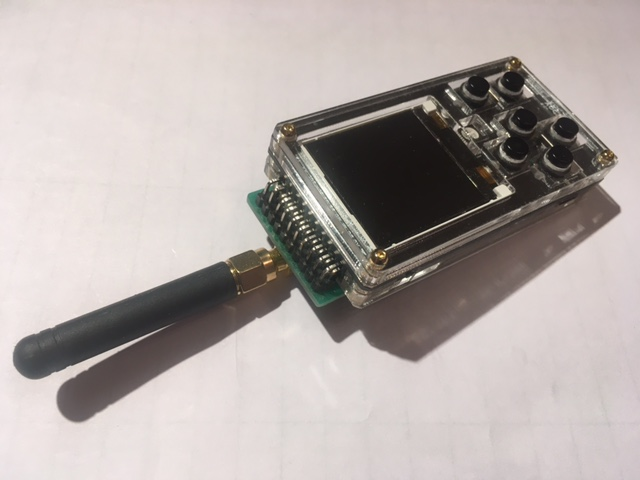
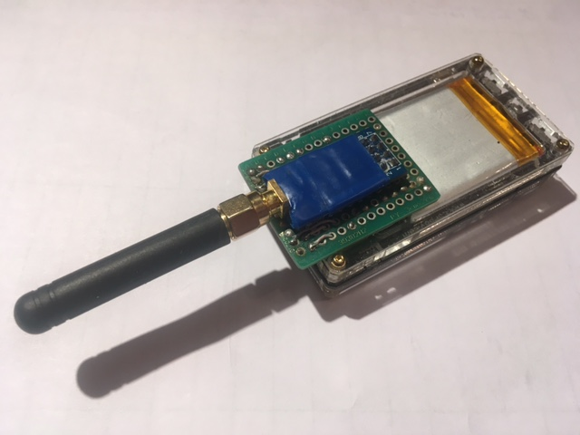
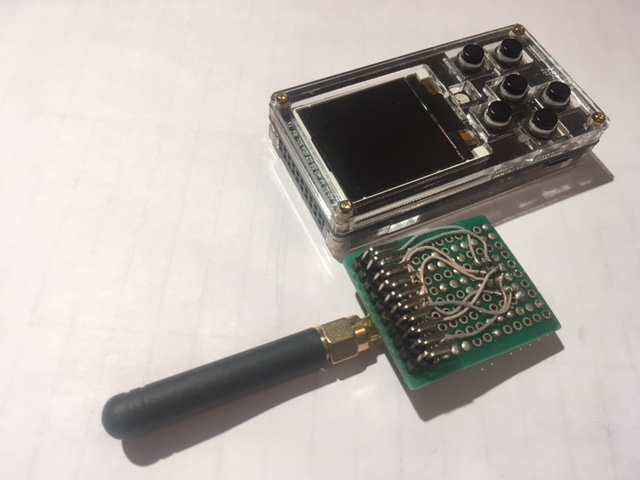
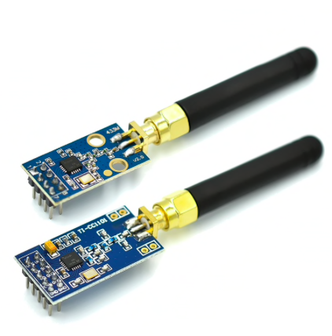
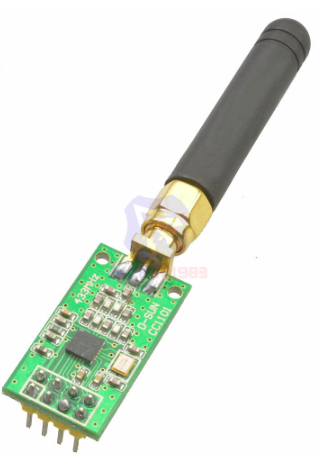

# ESPboy Sub1GHz Inspector v2.4

[Demo video](https://youtu.be/BxWNkIO8hpA)

The **ESPboy CC1101 Sub1GHz Inspector** module allows you to inspect, capture, decode, store, and transmit Sub-1GHz radio signals across major ISM bands (300–348 MHz, 387–464 MHz, 779–928 MHz). 

Analyze wireless protocols, decode keyfobs, store captured remotes in EEPROM, and control garage doors, barriers, remote outlets, and IoT sensors directly from your ESPboy.

---

## What's New in v2.4

- **Dynamic RF Settings Menu**: Configure Frequency (315/433.92/868.35 MHz), Modulation (ASK/OOK, 2-FSK, GFSK), RX Bandwidth, Data Rate, and Deviation on the fly.
- **FSK/GFSK Support**: Analyze signals from modern car keys (e.g., Volvo, Saab) and advanced IoT sensors that use frequency shift keying.
- **Live RSSI Meter**: Real-time signal strength indicator with a 5-star visual scale and `dBm` readout during the scanning phase.
- **Signal Quality Metrics**: Displays RSSI and LQI (Link Quality Indicator) for successfully decoded packets.
- **Persistent Configuration**: All RF settings are silently saved to the EEPROM and restored on boot.
- **Smooth UI Navigation**: Upgraded `ESPboyMenuGUI` allows parameter adjustment using D-pad left/right without screen flickering.
- **Hardware Conflict Resolution**: Moved CC1101 CSN (Chip Select) to the onboard MCP23017 port expander (**GPB2 / Pin 10**) to prevent SPI bus collisions.
- **Safe Boot Pinout**: Shifted GDO2 (RX) to `GPIO15` (D8) and GDO0 (TX) to `GPIO16` (D0), freeing up system pins and preventing boot lockups.

---

## 1. Compatible CC1101 Modules

Any standard 8-pin CC1101 breakout board with an external antenna connector is compatible:

- **Blue CC1101 Module** with antenna: [AliExpress Search](https://aliexpress.ru/item/2055139086.html)
  
  

- **Green CC1101 Module** with antenna (Not recommended, sensitivity is too low.): [AliExpress Search](https://aliexpress.ru/item/32858516951.html)
  
  

---

## 2. Pinout & Wiring

Connect the CC1101 module to the ESPboy expansion header as outlined below:

| CC1101 Pin (Green / Blue) | ESPboy Pin / Bus | ESP8266 GPIO | Description |
| :--- | :--- | :--- | :--- |
| **GND** (Pin 1) | **GND** | GND | Ground |
| **VCC** (Pin 2) | **3V3** | 3.3V | Power Supply (3.3V) |
| **GDO0** (TX) | **D0** | GPIO16 | TX Data Pin |
| **CSN** (SS) | **MCP23017 GPB2** | Pin 10 on MCP | Chip Select (via I2C expander) |
| **SCK** (Clock) | **D5** | GPIO14 | Hardware SPI Clock |
| **MOSI** | **D7** | GPIO13 | Hardware SPI MOSI |
| **MISO** | **D6** | GPIO12 | Hardware SPI MISO |
| **GDO2** (RX) | **D8** | GPIO15 | RX Data / Interrupt Pin |

> ⚠️ **Important Hardware Recommendation (Battery Stability):**  
> CC1101 modules are sensitive to supply noise and current spikes. To prevent reboots or receiver deafness when powered by the LiPo battery, solder a **$100\ \mu\text{F}$ tantalum SMD capacitor (marking 107C)** or an electrolytic capacitor directly across the CC1101 module's $V_{CC}$ and $GND$ pins.

---

## 3. Supported Protocols

The firmware decodes over 39 common fixed and dynamic protocols via the enhanced `rc-switch` engine, including:

- **Protocol 01**: Princeton, PT2240, PT2260, PT2262, EV1527
- **Protocol 06**: Holtek HT6P20B
- **Protocol 08**: Came 12-bit, HT12E
- **Protocol 09**: Nice FLO (12-bit dip-switch)
- **Protocol 10**: V2 Phoenix
- **Protocol 11**: Nice Flor-S (52-bit)
- **Protocol 12**: KeeLoq 64/66-bit
- **Protocol 16**: Einhell
- **Protocol 17 / 18**: Intertechno (PAR-1000, ITT-1500)
- **Protocol 22–24**: Mandolyn / Lidl (TR-502MSV, RC-402, RC701)
- **Protocol 29**: NEXA
- **Protocol 33 / 35 / 36**: Dooya shutter motors (DC2708L, DC1603, DC2700AC)
- And more (weather stations, alarm systems, smart plugs).

*Note: For FSK/GFSK based automotive keys (like Saab, Volvo), ensure you switch the modulation to 2-FSK or GFSK in the SETTINGS menu to capture raw timings properly.*

---

## 4. Compilation & Flashing

### Requirements
- Arduino IDE (v1.8.x or v2.x)
- ESP8266 Board Package (v3.0.2 or later)
- Core ESPboy libraries (`ESPboyInit`, `ESPboyTerminalGUI`, `ESPboyMenuGUI`)

### Arduino IDE Board Settings
- **Board**: `Generic ESP8266 Module` (or `WeMos D1 mini / Pro`)
- **CPU Frequency**: `160 MHz` *(Mandatory for reliable real-time signal sampling)*
- **Flash Size**: `4MB (FS: 2MB)` or `4MB (FS: 1MB)`
- **Upload Speed**: `921600` (or `115200` if unstable)

---

## 5. UI Controls

### In `LISTEN` and `LISTEN & STORE` Modes:
- **RF Capture**: Incoming recognized packets are decoded and displayed with DEC, BIN, TRI, Protocol ID, bit lengths, RSSI, and LQI.
- **Live RSSI Meter**: Watch the background noise and signal spikes in real-time at the bottom of the screen.
- **LFT / RGT / ACT**: Pauses live RF listening and enables terminal buffer scroll mode (`doScroll`).
- **ACT**: Resumes live RF scanning.
- **ESC**: Exits to the main menu.

### In `LIST OF STORED` Menu:
- **SEND**: Transmit the selected captured packet back via CC1101.
- **SHOW**: Inspect decoded metadata and raw timings.
- **SET REPEAT**: Adjust retransmission burst count.
- **RENAME / DELETE**: Organize saved codes stored in EEPROM.

### In `SETTINGS` Menu:
- Adjust **FREQ** (Frequency), **MOD** (Modulation), **RX BW** (Receiver Bandwidth), **DRATE** (Data Rate), and **DEV** (Deviation).
- Use `UP`/`DOWN` to navigate.
- Use `LEFT`/`RIGHT` or `ACT` to toggle parameter values on the fly.
- Select `BACK` or press `ESC` to silently apply and save the configuration to EEPROM.

---

## 6. Community & Links

- [Official ESPboy Website](https://www.espboy.com)
- [Hackaday Project Page](https://hackaday.io/project/164830-espboy-games-iot-stem-for-education-fun)
- [Buy ESPboy on Tindie](https://www.tindie.com/products/23910/)
- [DIY Schematics & Gerber on EasyEDA](https://easyeda.com/ESPboy)
- [ESPboy Community Forum](https://community.espboy.com)
- [Discord Community](https://discord.gg/kXfDQpX)
- [YouTube Channel](https://www.youtube.com/c/ESPboy)
- Contact: [espboy.edu@gmail.com](mailto:espboy.edu@gmail.com)
